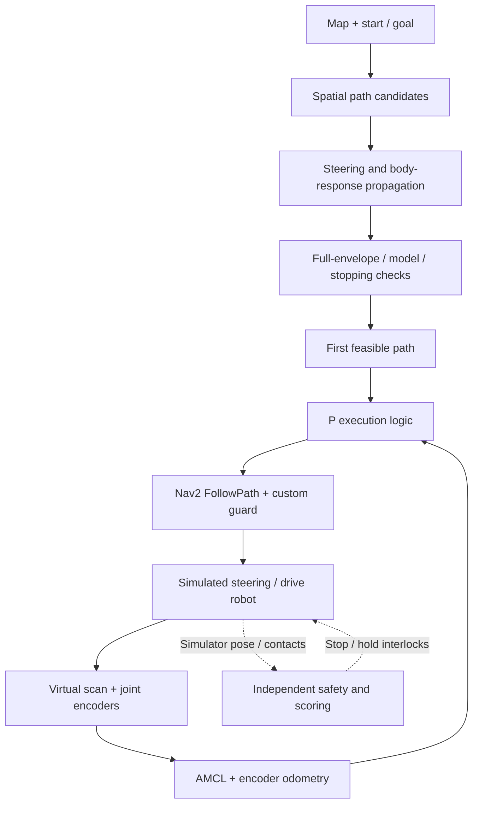

# Multi-Steering Motion Planning


전·후방 조향 구동륜과 네 개의 수동 캐스터를 갖춘 환자이승로봇의 **응답 모델 기반 다중 조향 경로계획** ROS 2 워크스페이스이다. 조향 전환과 차체 속도 응답을 예측하고, 전체 점유영역의 충돌 여부와 근사 물리 제약을 검사하여 병실 출발부터 목적지 침대 정렬까지의 경로를 선택한다.

Isaac Sim 병원 환경의 H1–H6 비교 실험, 상태 이력 제거 ablation, 전체 외곽 검사 비교와 별도 H5/H6 AMCL·엔코더·Nav2 통합 실행을 지원한다. 논문 실험에 사용한 내부 패키지명 `ijcas_experiments`, `patient_initial_stability`는 호환성을 위해 유지한다.

> 검증 범위는 시뮬레이션이다. 실물 플랫폼을 대상으로 한 동일 성능 검증이나 의료기기 안전 인증을 의미하지 않는다. 기본 명령은 설정 확인만 하며, 새 주행에는 `stage:=run allow_motion:=true`를 명시해야 한다.

## 핵심 기능

- 전륜 단독(F), 후륜 단독(R), 역위상(C) 조향을 사용하는 계층적 경로계획
- 구간 경계의 조향각·종/횡방향 속도·yaw rate 이력 전파
- 조향 전환 중 전체 차체 외곽 검사와 감속·방향 전환 연결 검사
- 근사 마찰 사용률·하중 전달 지표 계산 및 후보 검사
- 공통 속도 정책의 B0/B1/B2/P 비교와 H2/H3 상태 이력 제거 실험
- 가상 스캔·조인트 엔코더 → AMCL/오도메트리 → P 실행 로직 → Nav2 FollowPath 연결
- 원본 로그에서 시간 가중 Tracking RMS, 완료율 및 평균·표본 표준편차 재계산

## 1. 시스템 개요



P가 경로·조향 모드·전후진 방향·구간 목표 속도를 선택한다. Nav2는 센서 통합 사례에서 **이미 정해진 P 경로를 FollowPath로 실행하고 costmap 기반 검사를 수행**하며, P를 대신하는 전역 플래너가 아니다. 모드·방향·속도 정보는 ROS Path와 별도 인터페이스로 전달한다.

본 비교 실험은 ground-truth pose 피드백을 사용한다. AMCL/엔코더 피드백은 별도 H5/H6 기능 검증이며, 위치추정 실패 시 ground truth 제어로 전환하지 않는다. 지도 생성·초기 정적 검사·독립 안전 감시·사후 평가는 시뮬레이터 정보를 사용한다.

## 2. 검증 환경

| 항목 | 구성 |
|---|---|
| OS / ROS | Ubuntu 22.04 / ROS 2 Humble |
| Simulator | NVIDIA Isaac Sim 5.0 |
| Python | ROS 노드: 시스템 3.10 / Isaac SDK: 별도 3.11 |
| Native plugin | C++17, Nav2 controller / goal-checker |
| Platform | 전·후방 조향 구동륜 2개 + 수동 캐스터 4개, 총 질량 265 kg |
| Planning envelope | 1.630 × 0.965 m, wheelbase 1.330 m |
| Physics / recording | 120 Hz / 약 60 Hz |
| Sensor integration | 가상 평면 스캔 5 Hz, AMCL·엔코더 제어 자료 20 Hz |
| Completion | 최종 위치 30 mm / yaw 2°, 정지·접촉 하중 조건 포함 |

스캔은 360 rays, 0.1–12 m의 noise-free 가상 센서다. AMCL은 3 mm / 0.1°의 known-start prior를 사용한다. 전역 재측위·센서 잡음·실물 강건성을 검증한 결과로 확대 해석하지 않는다.

## 3. 실험 결과

### 공통 속도 정책의 최종 비교

H1–H6 각각 세 초기조건을 네 방법에 공통 적용한 고정 비교 블록이다. 표는 **계획 실패와 실제 주행 미완료를 포함한 전체 선언 조건**에 대한 완료 횟수다.

| Task | 내용 | B0 | B1 | B2 | P |
|---|---|---:|---:|---:|---:|
| H1 | Bedside departure | 0/3 | 2/3 | 3/3 | 3/3 |
| H2 | Bedside alignment | 1/3 | 3/3 | 1/3 | 3/3 |
| H3 | Turn after doorway passage | 0/3 | 0/3 | 0/3 | 3/3 |
| H4 | Corridor turn and connection | 0/3 | 0/3 | 1/3 | 2/3 |
| H5 | Fixed-cart bypass | 0/3 | 1/3 | 0/3 | 3/3 |
| H6 | Continuous bedside transfer | 0/3 | 0/3 | 0/3 | 3/3 |
| **Total** | **18 conditions / method** | **1/18** | **6/18** | **5/18** | **17/18** |

B0는 역위상 운동학, B1은 다중 모드 운동학, B2는 B1에 전환 비용을 추가한 방법이며 P는 응답 상태 전파와 후보 검사를 적용한다. 공통 cruise 정책은 30 mm/s다. 구간별 조향·정렬·감속으로 실제 속도 시계열까지 완전히 같다는 의미는 아니다. 본 비교 H6의 시간 한도는 **모든 방법에 600 simulation s / 1,500 wall s**, P lookahead는 **모든 과제에서 4**로 고정했다.

상태 이력 제거 실험, 완료 사례의 RMS·계획 시간 평균/표준편차와 독립 외곽 검사 자료는 [실험 문서](docs/EXPERIMENTS.md)와 [원자료에서 추출한 요약 표](docs/data/summary.csv)에 있다. 실패를 성공 재시도로 교체하거나, 미완료 구간 RMS를 전체 임무 성능과 섞어 집계하지 않는다.

### 별도 센서 통합 사례

| 항목 | H5 | H6 |
|---|---:|---:|
| Localization position RMS (mm) | 13.011 | 12.888 |
| Actual tracking position RMS (mm) | 22.343 | 23.053 |
| Actual tracking yaw RMS (deg) | 1.186 | 0.953 |
| Final absolute position error (mm) | 23.073 | 19.246 |
| Actual distance (m) | 5.5256 | 12.1174 |
| Travel simulation time (s) | 135.800 | 409.600 |
| Action / task criteria | Completed / satisfied | Completed / satisfied |

각 과제 한 사례의 기능 검증이다. 새 ROS 실행기에서도 H5 8,149개 / H6 24,577개 physics 표본과 각각 2,717개 / 8,193개 제어 기록을 대조하여 기존 센서 사례와 일치를 확인했다. 이 실행은 본 비교 72조건의 통계에 추가하지 않았다. 타 PC의 bitwise 재현이나 wall-clock 시간 일치를 보장하지 않는다.

## 4. 저장소 구조

```text
multi-steering-motion-planning/
├── README.md
├── src/
│   ├── ijcas_experiments/         # ROS 실행 선택기, launch, 결과 재계산
│   ├── patient_initial_stability/# 공유 계획·응답 모델
│   ├── ijcas_nav2_sensor_adapter/# Nav2 C++ controller / collision guard
│   ├── patient_transport_description/
│   └── wheelchair_description/   # 유지된 모델 의존성
├── studies/IJCAS/
│   ├── scripts/                  # 최종 실행기가 참조하는 내부 호환 라이브러리
│   ├── config/                   # 과제·기하·실험 정의
│   └── THIRD_PARTY_NOTICES.txt
├── isaac/                        # 로봇 USD, 병원 scene, SDK 호스트
├── config/                       # 플랫폼 설정
├── tools/                        # 경로 해석, 원본 검증, USD 참조 검사
└── docs/
    ├── ARCHITECTURE.md
    ├── SETUP.md
    ├── EXPERIMENTS.md
    ├── TROUBLESHOOTING.md
    ├── THIRD_PARTY.md
    └── data/                     # 경로·raw trace를 제외한 측정 결과 요약
```

`build/`, `install/`, `log/`, 원본 실험 로그, 로컬 이관 기록과 개발 보관본은 Git에서 제외한다. `studies/IJCAS/scripts`와 `isaac/scripts`는 최종 실행기의 의존성을 보존한 내부 코드이며, 사용자가 과제마다 Script Editor에 복사하는 실행 방식이 아니다.

## 5. 빠른 시작

### 설치와 빌드

```bash
git clone https://github.com/jk2001-king/multi-steering-motion-planning.git ~/IJCAS_ws
cd ~/IJCAS_ws
source /opt/ros/humble/setup.bash

rosdep install --from-paths src --ignore-src -r -y
colcon build --base-paths src --symlink-install
source install/setup.bash
```

Isaac Sim 5.0 / SDK Python 환경은 별도로 설치해야 한다. ROS의 Python 3.10 라이브러리와 SDK의 Python 3.11 바이너리 경로를 섞지 않는다. 자세한 내용은 [환경 설정 문서](docs/SETUP.md)에 있다.

> **코드 복제본의 경계:** 약 14 GB의 원본 로그·지도/기하·고정 실행 정의·이관 증빙은 이 저장소에 업로드하지 않는다. 빌드와 선택 항목 목록은 코드만으로 가능하지만, 아래의 설정 확인·계획·주행·원본 결과 재계산은 해당 입력 자료를 원래 상대경로에 복원해야 한다. `docs/data`의 요약 표는 실행 입력의 대체물이 아니다. NVIDIA 병원/Grid 자산도 별도 접근 권한이 필요하다.

### 선택 항목 확인

```bash
source install/setup.bash
ros2 run ijcas_experiments experiment --list

# 아래부터는 원본 실행 입력 자료가 필요하다. 설정 확인만 하며 새 주행은 없다.
ros2 run ijcas_experiments check
ros2 launch ijcas_experiments experiment.launch.py \
  environment:=hospital scenario:=H2 method:=P condition:=3 \
  feedback:=ground_truth stage:=check
```

### 새 시뮬레이션 한 조건 실행

```bash
ros2 launch ijcas_experiments experiment.launch.py \
  scenario:=H2 method:=P condition:=3 feedback:=ground_truth \
  stage:=run allow_motion:=true headless:=true \
  sdk_python:=/path/to/isaac_env/bin/python
```

새 로봇 생성 → 원본 정적 검사 → 통과 시 한 경로 실행 → 정지 유지 → 실제 Pause·게인/목표 복원을 수행한다. 기존 결과를 덮어쓰거나 물리 주행을 자동 재시도하지 않는다.

### 별도 H5/H6 센서 통합 실행

```bash
ros2 launch ijcas_experiments experiment.launch.py \
  scenario:=H5 method:=P condition:=1 feedback:=amcl_encoder \
  stage:=run allow_motion:=true headless:=true \
  sdk_python:=/path/to/isaac_env/bin/python
```

H6는 `scenario:=H6`로 선택한다. 센서 모드의 `condition:=1`은 본 비교의 첫 초기조건이 아니라 별도로 보관된 센서 사례다. H6 센서 기능 검증은 기존과 같은 600 simulation s / 3,000 wall s 한도를 사용한다.

### 원본 결과 재계산

```bash
ros2 run ijcas_experiments reproduce_results
# 동등한 launch
ros2 launch ijcas_experiments reproduce.launch.py
```

새 시뮬레이션 없이 고정 원본 로그를 읽고 시간 가중 RMS·평균·표본 표준편차를 재계산한다. 산출물은 새 `results/reproduced/<timestamp>/`에 저장하며, 계획 시간은 원래 측정값을 유지한다.

## 6. 실행 인자

| 인자 | 선택값 / 기본값 | 의미 |
|---|---|---|
| `environment` | `hospital` | 등록된 병원 장면 |
| `scenario` | `H1`–`H6` / `H2` | 과제 |
| `method` | `B0`, `B1`, `B2`, `P`, `P_no_history` / `P` | 계획 구성; 이력 제거는 H2/H3만 |
| `condition` | `1`, `2`, `3` / `1` | 보관된 초기 pose·joint 조건 |
| `feedback` | `ground_truth`, `amcl_encoder` | 센서는 H5/H6의 P·condition 1만 |
| `stage` | `check`, `plan`, `run`, `analyze` / `check` | 확인 / 계획 / 새 주행 / 원본 분석 |
| `allow_motion` | `false` | 새 주행은 명시적으로 `true` 필요 |
| `headless` | `false` | 창 없는 SDK 실행 |
| `sdk_python` | 자동 탐색 또는 명시 경로 | Isaac SDK Python |
| `output` | 새 `results/experiments/<timestamp>_<cell>/` | 기존 폴더 재사용 금지 |

YAML 선택 파일도 지원한다. 명령행 인자가 YAML보다 우선한다.

```bash
ros2 launch ijcas_experiments experiment.launch.py \
  config:=src/ijcas_experiments/config/h2_p.yaml stage:=plan
```

## 7. 검증과 문서

```bash
python3 -m pytest src/ijcas_experiments/test -q
```

로컬 원본 자료가 있는 환경에서 최종 실행 인터페이스 테스트 75개와 5개 ROS 패키지 빌드를 확인했다. 자료가 없는 코드 복제본에서 자료 의존 테스트까지 통과한다고 주장하지 않는다. 과거 전체 테스트 모음의 일부 고정 fixture는 별도 SDK/보관 자료가 필요하다.

- [계획·실행·센서 연결](docs/ARCHITECTURE.md)
- [환경 설치와 원본 입력 복원](docs/SETUP.md)
- [실험 조건·평가 정의·결과와 한계](docs/EXPERIMENTS.md)
- [경로·Python 환경·주행 중단 문제 해결](docs/TROUBLESHOOTING.md)
- [외부 자산과 라이선스](docs/THIRD_PARTY.md)

## 8. 외부 자산과 라이선스

NVIDIA Isaac Sim과 Hospital/Grid 자산은 별도 배포물이며 이 저장소에 해당 환경 자산을 재배포하지 않는다. scene에는 외부 참조만 있다. CPython 수치 호환 코드의 PSF 고지는 그대로 유지한다. OMPL은 선택적 시스템 의존성으로 소스·바이너리를 포함하지 않는다.

패키지별 `package.xml`의 기존 라이선스 표기를 유지했으며, `UNLICENSED` 구성요소를 포함하므로 프로젝트 전체에 새 MIT/Apache 라이선스를 일괄 선언하지 않는다. 자세한 범위는 [외부 구성요소 문서](docs/THIRD_PARTY.md)를 따른다.
